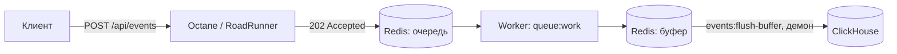

# Highload Analytics Service

Асинхронный сервис аналитики: приём событий → очередь → ClickHouse.

## Стек
Laravel 13 · Octane (RoadRunner) · ClickHouse · Redis · Prometheus/Grafana · Elasticsearch/Kibana (EFK) · k6 · Kubernetes · GitHub Actions (CI/CD)

## Архитектура


## Схема данных
events (партиции по дате, TTL 90 дней, MV page_views_daily)

## API

### `POST /api/events`
Принимает событие и сразу отвечает `202 Accepted` — запись в ClickHouse происходит асинхронно через очередь и буфер.

```bash
curl -X POST http://localhost:8080/api/events \
  -H "Content-Type: application/json" \
  -d '{"event_type": "page_view", "user_id": 42, "payload": {"url": "/home"}}'
# 202 {"status":"accepted"}
```

`event_type` — один из `page_view`, `purchase`, `signup`. Rate limit: 1000 запросов/сек на IP (`throttle:events`, см. `RateLimiter::for('events', ...)` в `AppServiceProvider`).

### `POST /api/login`
Выдаёт Sanctum-токен по email/паролю — см. раздел [Авторизация](#авторизация). Rate limit: 5 запросов/мин на IP (`throttle:login`) — защита от подбора пароля.

```bash
curl -X POST http://localhost:8080/api/login \
  -H "Content-Type: application/json" \
  -d '{"email": "test@example.com", "password": "password"}'
# 200 {"token":"1|xxxxxxxxxxxxxxxxxxxxxxxxxxxxxxxxxxxxxxxxxxxxxxxx"}
```

### `GET /api/analytics/page-views?days=7` 🔒
Просмотры страниц по дням за последние N дней (1–90, по умолчанию 7). Результат кэшируется на 60 секунд. Требует авторизации — см. раздел [Авторизация](#авторизация).

```bash
curl http://localhost:8080/api/analytics/page-views?days=7 \
  -H "Authorization: Bearer <токен>"
```

### `GET /api/analytics/conversion?days=7` 🔒
Воронка конверсии (доля пользователей по типам событий) за последние N дней. Кэш 60 секунд. Требует авторизации.

```bash
curl http://localhost:8080/api/analytics/conversion?days=7 \
  -H "Authorization: Bearer <токен>"
```

### `GET /health`
Проверка доступности кэша и ClickHouse — `{"status":"ok"}` либо `503 {"status":"degraded","error":"..."}`.

### `GET /metrics`
Метрики в формате Prometheus text exposition.

## Авторизация

`POST /api/events` — публичный, без авторизации. Это beacon-эндпоинт (его дёргают напрямую из браузера/мобильного клиента, как у Google Analytics/Segment) — требовать Bearer-токен означало бы, что нельзя трекать анонимных посетителей. Защита от злоупотреблений — `throttle:events` (1000 запросов/сек на IP, см. `AppServiceProvider`).

`GET /api/analytics/*` — это внутренние бизнес-данные, защищены middleware `auth:sanctum`. Без валидного токена — `401 Unauthorized`.

**Как это работает:** модель `App\Models\User` использует `Laravel\Sanctum\HasApiTokens` — personal access-токены хранятся в таблице `personal_access_tokens`. `POST /api/login` (см. `AuthService`) проверяет email/пароль и выдаёт токен через `$user->createToken(...)->plainTextToken`. Guard `sanctum` при запросе к защищённым роутам сначала пытается распознать этот Bearer-токен из заголовка `Authorization`; если токена нет — откатывается на guard'ы из `config('sanctum.guard')` (по умолчанию `web`, то есть обычная сессионная авторизация тоже подходит).

Регистрации пока нет — только сидированный тестовый пользователь (см. «Запуск (локально)» ниже):

| email | password |
|---|---|
| `test@example.com` | `password` |

⚠️ Эти креды — только для локальной разработки (`DatabaseSeeder`), в проекте нет UI регистрации и никакой другой источник пользователей не предполагается. Не разворачивать с этим сидером на публично доступном окружении.

Получить токен и обратиться к защищённому эндпоинту:

```bash
TOKEN=$(curl -s -X POST http://localhost:8080/api/login \
  -H "Content-Type: application/json" \
  -d '{"email": "test@example.com", "password": "password"}' | jq -r .token)

curl http://localhost:8080/api/analytics/page-views -H "Authorization: Bearer $TOKEN"
```

Для дополнительных/кастомных пользователей — `php artisan tinker` (`User::factory()->create([...])`).

## Запуск (локально)

Одной командой (см. `Makefile`, `make help` — список всех команд):
```bash
make setup
```

Или вручную теми же шагами, что делает `make setup`:
```bash
cp .env.example .env
docker compose build
docker compose run --rm app php artisan key:generate
docker compose up -d
docker compose exec app php artisan clickhouse:migrate
docker compose exec app php artisan migrate --seed
```

`docker compose up -d` поднимает весь конвейер целиком:
- `app` — Octane/RoadRunner, HTTP (`:8080`);
- `worker` — `queue:work`, разбирает очередь `ProcessEventJob` и кладёт события в Redis-буфер;
- `scheduler` — `events:flush-buffer`, постоянно работающий демон, переносит события из буфера в ClickHouse батчами (SLO 50K+ строк/сек) без ожидания тика планировщика.

Без `worker`/`scheduler` события будут приниматься (202), но никогда не долетят до ClickHouse.

`php artisan migrate --seed` — отдельная (SQLite) база под `users`/`personal_access_tokens` (не ClickHouse): создаёт таблицы и сидирует тестового пользователя `test@example.com` / `password` для `/api/login` (см. [Авторизация](#авторизация)).

## Мониторинг (Prometheus/Grafana)

- **Prometheus** — [http://localhost:9091](http://localhost:9091) (хостовый порт `9091`; внутри docker-сети контейнер слушает стандартные `9090`). Конфиг — `prometheus.yml`, job `laravel-app`, скрейпит `app:8080/metrics` каждые 15 сек.
- **Grafana** — [http://localhost:3000](http://localhost:3000), дашборд открывается сразу без логина (анонимный доступ с ролью Viewer — только для локальной разработки). Для правок — `admin`/`admin`.

Datasource и дашборд подняты через provisioning as code (`grafana/provisioning/`, `grafana/dashboards/`) — ничего не нужно настраивать руками в UI. Дашборд «Highload Analytics Service»:
- App Health (`app_app_health`);
- Requests за период / Requests в секунду / Error Rate 5xx (`app_http_requests_total`);
- Request Rate по route и по статус-коду;
- Latency percentiles p50/p95/p99 и p95 по route (`app_http_duration_ms`).

Сгенерировать трафик, чтобы увидеть на графиках реальные данные:
```bash
for i in $(seq 1 20); do
  curl -s -o /dev/null -X POST http://localhost:8080/api/events \
    -H "Content-Type: application/json" \
    -d '{"event_type":"page_view","user_id":1,"metadata":{}}'
done
```

## Логи (Elasticsearch/Kibana)

Лёгкий EFK (Elasticsearch/Filebeat/Kibana, без Logstash — не нужен, приложение само отдаёт готовый JSON):

- **Kibana** — [http://localhost:5601](http://localhost:5601) → *Discover*, data view «Laravel logs» (`laravel-logs-*`) поднят через provisioning автоматически (сервис `kibana-setup`, одноразовый вызов Kibana Saved Objects API — у Kibana, в отличие от Grafana, нет штатного файлового provisioning для data views).
- **Elasticsearch** — [http://localhost:9200](http://localhost:9200) (single-node dev-режим, без security/TLS — только для локальной разработки).

Как логи туда попадают: `config/logging.php` → канал `stdout_json` (структурированный JSON, добавлен в `LOG_STACK` поверх обычного человекочитаемого `single`) пишет в stdout контейнера, а не в файл. Docker сам захватывает stdout контейнера в свои json-log файлы на хосте, и Filebeat читает их напрямую через Docker autodiscover (`filebeat/filebeat.yml`) — без общих volume с `app`/`worker`/`scheduler`. Autodiscover фильтрует по имени образа (`highload-app`), так что логи ClickHouse/Redis/Prometheus/Grafana в индекс не попадают.

Проверить вживую (пример — намеренно повреждённое событие в буфере, чтобы увидеть реальную запись `Log::error` из `FlushEventsBufferCommand`):
```bash
docker compose exec app php artisan tinker --execute='
  \Illuminate\Support\Facades\Redis::rpush(config("events.buffer_key"), "{битый json");
'
# через несколько секунд запись появится в Kibana Discover
```

⚠️ На самом первом холодном старте (`docker compose up` на чистом томе `es_data`) в логах `filebeat` возможна одна transient-ошибка `no matching index template` — Filebeat регистрирует свой index template и пытается писать первое событие почти одновременно, самая первая попытка иногда проигрывает эту гонку. Самовосстанавливается за 1-2 секунды через штатный retry, ничего не теряется и делать ничего не нужно.

## Тестирование
Прод-образ (`Dockerfile`) собирается с `composer install --no-dev`, поэтому PHPUnit/Mockery/Faker в контейнере `app` намеренно отсутствуют — тесты гоняются локально (PHP 8.3+ и Composer) либо в CI:

```bash
composer install
make check   # test + stan + audit, то же самое, что джоба test в CI
```

97 тестов (Unit + Feature): DTO/enum, сервисы, репозитории, джоба, form request, HTTP-контроллеры, консольные команды, health/metrics-роуты, авторизация. Покрытие строк — 94.51% (`php artisan test --coverage-text`, нужен `pcov`/`xdebug`). Тот же набор + `composer run stan` + `composer audit` гоняются в CI (`.github/workflows/deploy.yml`, джоба `test`) на каждый пуш в `main`.

## Запуск (Kubernetes)

Одной командой:
```bash
make k8s-up     # kind create cluster + namespace + секрет APP_KEY + kubectl apply -f k8s/
make k8s-down   # удалить кластер
```

Или вручную теми же шагами:
```bash
kind create cluster
kubectl apply -f k8s/namespace.yaml
kubectl create secret generic analytics-secret \
  --from-literal=APP_KEY="$(php artisan key:generate --show)" \
  -n analytics
kubectl apply -f k8s/
```

Namespace нужно применять первым отдельно — остальные манифесты (`configmap`, `deployment-*`) уже ссылаются на namespace `analytics`, и `kubectl apply -f k8s/` обрабатывает файлы в алфавитном порядке (`namespace.yaml` — последний), иначе будет ошибка `namespaces "analytics" not found`. Так же (двумя шагами) делает и `deploy.yml` в CI.

`APP_KEY` — реальный секрет (шифрование кук/сессий Laravel), поэтому в `k8s/` нет коммитящегося `secret.yaml` с ключом (`Secret.data` — это base64, не шифрование, хранить там реальный ключ в git так же плохо, как в ConfigMap). Без этого шага поды `app`/`worker`/`scheduler` падают в `CrashLoopBackOff` сразу при старте (`MissingAppKeyException`) — проверено вживую. В CI то же самое делается из репозиторного секрета `APP_KEY` (Settings → Secrets and variables → Actions в GitHub), см. `deploy.yml`.

`k8s/configmap.yaml` рассчитан на локальное тестирование в `kind`: `CLICKHOUSE_HOST`/`REDIS_HOST` = `host.docker.internal`, т.е. ClickHouse и Redis ожидаются поднятыми на хосте через `docker compose up -d` (см. выше), а поды достают до них через `hostAliases`. Для реального прод-кластера эти значения нужно заменить на адреса настоящих Redis/ClickHouse.

## Результаты нагрузочного тестирования (k6)

| Тест | RPS | P95 latency | Ошибки | Вывод |
|---|---|---|---|---|
| Smoke (1 VU) | 612 | 1.73 ms | 0 | Базовая проверка, запас по SLO в 45 раз |
| Load (500 VU) | 377 | 3.21 ms | 0 | Узкое место — 1 воркер, очередь росла (пик 9.6K), догнал после теста |

SLO `P95 < 150ms` — выполняется с большим запасом. SLO `1000+ RPS` требует повторного замера на реальном сервере: локальные цифры недостоверны (см. `TESTING.md`).
